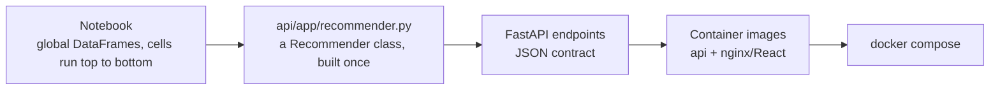

# From notebook to service

1. **Extract the logic.** The notebook built global DataFrames and a `movie_recommender_run()` function, and the old Streamlit app imported the notebook itself (`ipynb.fs.full`). That's now a `Recommender` class that builds the user × movie matrix and the similarity matrix once, when the API starts.
2. **Fix small issues on the way.** The matrix is built with vectorized indexing instead of `itertuples`. Each user is excluded from their own neighbour set (in the notebook a user's similarity to themselves is 1, so they always took one of the k slots). Unknown users now get a 404 instead of an `IndexError`.
3. **Define the contract.** There are endpoints for users, history, recommendations and rating distributions. The React app only talks to the API, through nginx's `/api` proxy.
4. **Test it.** Small synthetic fixtures check the algorithm, and one test loads the real CSVs. CI runs the tests and builds both images.
5. **Containerize.** The API image includes the CSVs (4 MB) and has a healthcheck. The web image is a multi-stage Node build served by nginx.

## Going further (not needed locally)
- The similarity matrix is 944 × 944 and fits easily in memory. At much larger scale, switch to approximate nearest neighbours (FAISS or Annoy) or matrix factorization (implicit ALS).
- Move the ratings into a database and refresh the matrix on a schedule.
- Evaluate with precision@k or recall@k on a time-based holdout before changing the algorithm.
- Cache recommendations for each user.
