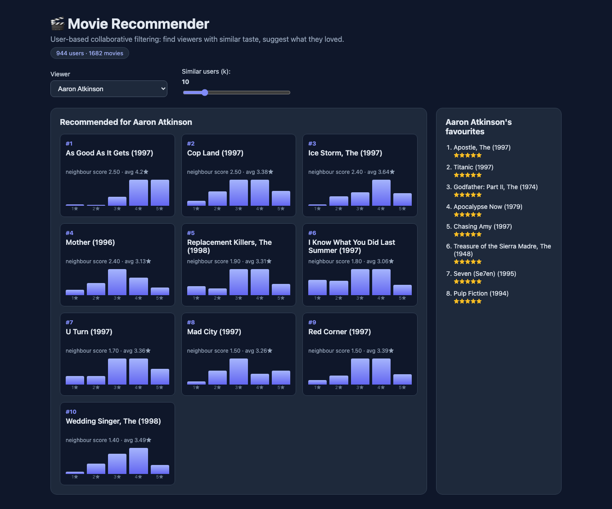
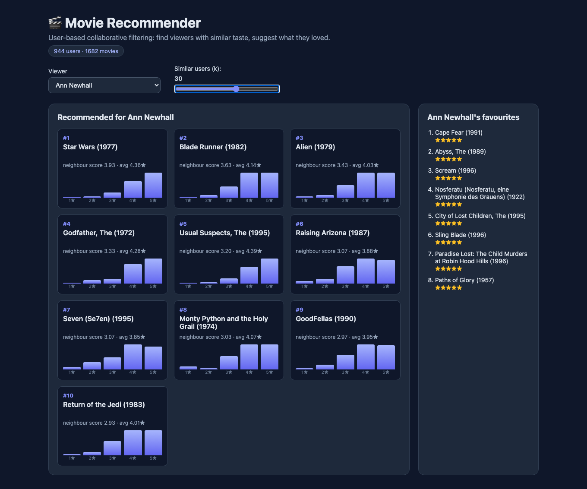
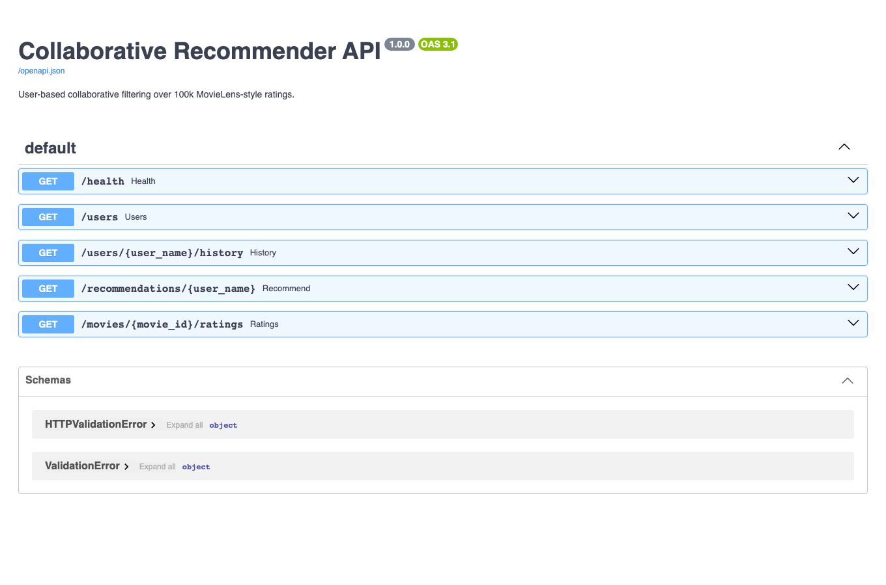
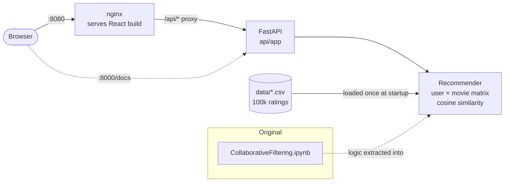
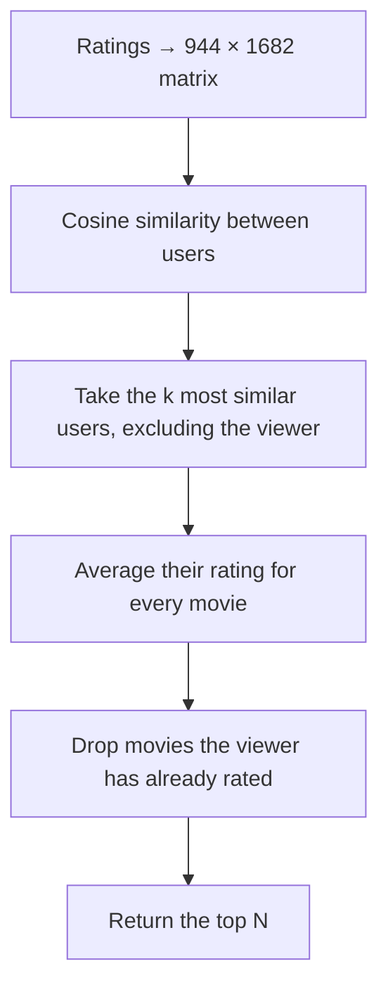

# 🎬 Collaborative Filtering Movie Recommender

**Pick a viewer, find the people who rate movies like they do, and recommend what those people loved. Runs locally with one command.**

The algorithm comes from `CollaborativeFiltering.ipynb`: user-based collaborative filtering with cosine similarity over 100,000 ratings (944 users, 1,682 movies). It's now packaged as a FastAPI service with a React front end.



---

## Quick start

```bash
cp .env.example .env
docker compose up --build
```

| Service | URL |
|---|---|
| React app (nginx) | http://localhost:8080 |
| FastAPI (Swagger docs) | http://localhost:8000/docs |

## The app

### 1. Choose a viewer and the neighbourhood size
The **viewer** dropdown lists all 944 users. The **k** slider sets how many of the most similar users vote on each recommendation.

### 2. Read the recommendations
Each card shows a movie the viewer hasn't rated yet, its neighbour score (the mean rating from the k similar users), its overall average, and its full 1–5★ rating distribution. The right-hand panel lists the viewer's own top-rated films, so you can check whether the suggestions make sense.



### 3. Use the API directly

```bash
curl 'localhost:8000/recommendations/Shawn%20Wilson?k=10&top_n=5'
curl  localhost:8000/movies/50/ratings
```



| Endpoint | Purpose |
|---|---|
| `GET /health` | Status, plus user and movie counts |
| `GET /users` | All viewer names |
| `GET /users/{name}/history` | The viewer's top-rated movies |
| `GET /recommendations/{name}?k=&top_n=` | Unseen movies ranked by the k nearest users |
| `GET /movies/{id}/ratings` | Rating distribution and mean for a movie |

## Architecture



How a recommendation is made:



## Repo layout

| Path | What it is |
|---|---|
| `api/` | FastAPI service, recommender module and Dockerfile |
| `web/` | React + Vite + TypeScript app, built and served by nginx |
| `data/` | The ratings and titles CSVs |
| `tests/` | Unit and API tests, including one test on the real dataset |
| `scripts/screenshots.py` | Regenerates `docs/screenshots/` with Playwright |
| `CollaborativeFiltering.ipynb` | Original exploration notebook |
| `legacy/` | The original Streamlit app and its screenshots |

## Development

```bash
pip install -r requirements-dev.txt && pytest -q        # tests
uvicorn app.main:app --app-dir api --reload              # API on :8000 (set DATA_DIR=data)
cd web && npm install && npm run dev                     # React on :5173, proxies /api to :8000
```

CI (GitHub Actions) runs the tests and then `docker compose build` on every PR.
